# UTS Faculty of Transdisciplinary Innovation
## 36120 Advanced Machine Learning Applications — Assessment Task 2
# Predictive Weather Intelligence Microservices: Forecasting Climate Comfort and Severe Weather Hazards

**Student Name:** Aryan Goel  
**Student ID:** 26040826  
**Subject:** 36120 — Advanced Machine Learning Applications  
**Assessment:** Assessment Task 2 — Machine Learning as a Service (Individual Assessment)  
**Experimentation Repository:** [https://github.com/16aryan/36120-26SP-AT2-26040826-experiments](https://github.com/16aryan/36120-26SP-AT2-26040826-experiments)  
**FastAPI Deployment Repository:** [https://github.com/16aryan/36120-26SP-AT2-26040826-api](https://github.com/16aryan/36120-26SP-AT2-26040826-api)  
**Custom TestPyPI Package:** [`nba-prep-26040826` v0.4.0](https://test.pypi.org/project/nba-prep-26040826/0.4.0/)  
**Render Production Microservice:** [https://weather-intel-api-26040826.onrender.com](https://weather-intel-api-26040826.onrender.com)  

---

## Executive Summary

As atmospheric volatility increases under anthropogenic climate disruption, enterprise operations, municipal transit systems, and public health authorities require predictive, low-latency meteorological intelligence rather than retrospective observations. Numerical Weather Prediction (NWP) models excel at physics-based atmospheric fluid dynamics but output raw physical parameters that are unintuitive for non-specialist decision-makers. This project designs, evaluates, and deploys a production-grade machine learning service for Open Meteo that forecasts two actionable, human-centric indices for Sydney, New South Wales, Australia (-33.8688° S, 151.2093° E):

1. **Target 1: Climate Comfort Index (CCI) [Regression]:** A multi-horizon direct forecasting service predicting outdoor human suitability across the next three days ($t+1, t+2, t+3$), bounded in $[0, 100]$.
2. **Target 2: Weather Hazard Category (WHC) [Multiclass Classification]:** A cost-sensitive predictive classification service forecasting four operational hazard tiers (Low, Moderate, High, Extreme Risk) with an exact $+7$-day lead time.

The system is trained and evaluated on an 8-year historical record (2018–2025; $N = 2,922$ daily records aggregated from 70,128 hourly readings) extracted from the Open-Meteo Historical Archive API. A strict chronological boundary split (2018–2023 Training, 2024 Validation, 2025 Holdout Testing) guarantees zero temporal data leakage. All data transformations and target derivation logic are packaged into the custom Python package `nba-prep-26040826` (extended to v0.4.0 and published to TestPyPI). 

Systematic model comparisons demonstrated that a regularised linear model (Ridge Regression, $\alpha=10.0$) and Random Forest Regressor outperformed the naive persistence benchmark by over $1.98$ RMSE points on the 2025 holdout test set (confirming Hypothesis 1). For hazard classification, a Balanced Random Forest Classifier achieved a Macro F1-Score of $0.2792$ and Balanced Accuracy of $0.2880$, overcoming extreme class imbalance (Class 3 represents only $0.24\%$ of historical observations) and confirming Hypothesis 2. The solution is deployed as a Dockerised FastAPI microservice exposing five RESTful endpoints with sub-10ms response latency, verified by automated unit tests (`28/28` passed in experimentation, `8/8` passed in API). Ethical considerations—including First Nations Gadigal/Eora seasonal ecological knowledge, Indigenous Data Sovereignty (CARE Principles), vulnerable outdoor worker safety, and Western Sydney Urban Heat Island equity—are critically analysed alongside a three-phase commercial adoption roadmap.

---

## 1. Business Context & Problem Formulation

### 1.1 Organisational Scenario
Open Meteo recently modernised its global meteorological platform from a monolithic infrastructure to a microservice-based REST architecture. To deliver higher commercial value, Open Meteo initiated a machine-learning transformation program aimed at developing predictive intelligence services that translate raw environmental sensor measurements into forward-looking decision metrics. As the assigned Machine Learning Engineer, the mandate encompasses end-to-end design: target variable derivation, leakage-free feature engineering, systematic experimentation, packaging into an open-source library, and cloud microservice deployment.

### 1.2 Target 1: Climate Comfort Index (CCI)
The Climate Comfort Index measures the suitability of atmospheric conditions for human outdoor activities. Outdoor tourism operators, hospitality venues, municipal recreation departments, and event organizers require short-term forward visibility into outdoor suitability to schedule outdoor events, optimize casual staffing rosters, and procure perishable inventory.
- **Forecasting Paradigm:** Multi-step direct regression across a three-day rolling window ($t+1, t+2, t+3$).
- **Scale:** Continuous index bounded in $[0, 100]$.
- **Evaluation Criteria:** Root Mean Squared Error (RMSE), Mean Absolute Error (MAE), and Coefficient of Determination ($R^2$).

### 1.3 Target 2: Weather Hazard Category (WHC)
The Weather Hazard Category categorises meteorological severity into four discrete operational impact levels: Low Risk, Moderate Risk, High Risk, and Extreme Risk. Transport agencies (Transport for NSW, Sydney Trains, Sydney Ferries), civil construction contractors, logistics providers, and emergency services require medium-range (7-day) risk indicators to schedule drainage maintenance, plan high-wind crane operations, and position emergency crews.
- **Forecasting Paradigm:** Ordinal 4-class classification.
- **Forecast Horizon:** Exactly $+7$ days ahead ($t+7$).
- **Core Technical Challenge:** Severe class imbalance ($>95\%$ benign conditions), requiring cost-sensitive loss functions and macro-averaged evaluation metrics.

---

## 2. Data Sourcing & Acquisition Methodology

### 2.1 Geographic Target & Temporal Scope
All historical meteorological observations correspond strictly to the mandated geographic coordinates:
- **Location:** Sydney, New South Wales, Australia
- **Latitude:** `-33.8688`
- **Longitude:** `151.2093`
- **Query Timezone:** `Australia/Sydney` (AEST/AEDT, UTC+10 / UTC+11)
- **Temporal Interval:** `2018-01-01` to `2025-12-31` (8 full years; $2,922$ calendar days)
- **Production Isolation Boundary:** In strict adherence to assignment instructions, **all data from 2026-01-01 onwards is treated as inaccessible production holdout data**. No data from 2026 was retrieved or used during model development.

Explicitly specifying the timezone as `Australia/Sydney` ensures that hourly atmospheric observations are aligned with local solar days (midnight-to-midnight local time), preventing date boundary phase shifts that occur when UTC observations are aggregated across the international date line.

### 2.2 Extraction Protocol & Aggregation Rules
Observations were extracted from the Open-Meteo Historical Archive API (`https://archive-api.open-meteo.com/v1/archive`). The variables collected, their physical units, and their daily aggregation functions are presented in Table 1.

| Variable Name | API Identifier | Measurement Unit | Daily Aggregation Function | Target Consumer | Meteorological Rationale |
|---|---|---|---|---|---|
| Air Temperature (2m) | `temperature_2m` | °C | Daily Mean | CCI, WHC | Baseline sensible thermal energy |
| Relative Humidity (2m) | `relative_humidity_2m` | % | Daily Mean | CCI | Evaporative cooling constraint |
| Wind Speed (10m) | `wind_speed_10m` | km/h | Daily Mean | CCI | Convective heat loss & physical comfort |
| Peak Wind Gusts (10m) | `wind_gusts_10m` | km/h | Daily Maximum | WHC | Mechanical shear & structural hazard |
| Total Cloud Cover | `cloud_cover` | % | Daily Mean | CCI, WHC | Solar insolation attenuation |
| Precipitation | `precipitation` | mm | Daily Total (Sum) | CCI, WHC | Hydrological volume & outdoor disruption |
| Snowfall | `snowfall` | cm | Daily Total (Sum) | WHC | Frozen precipitation hazard |

*Table 1: Meteorological variable definitions, API parameters, and daily aggregation methods.*

Extraction integrity checks confirmed 70,128 consecutive hourly readings with zero missing timestamps. Daily aggregation collapsed these into exactly 2,922 days ($8 \times 365 + 2$ leap days). Physical range validation verified that relative humidity and cloud cover remain strictly within $[0, 100]\%$, precipitation $\ge 0$ mm, and snowfall was identically zero (reflecting Sydney's temperate coastal climate).

---

## 3. Mathematical Formulation of Target Variables

Both targets were calculated prior to model training in strict accordance with the assessment brief's mathematical definitions.

### 3.1 Climate Comfort Index (CCI) — Regression Target
CCI combines five sub-component comfort scores evaluated on daily aggregated values:

$$\text{TempScore} = \max\left(0, 1 - \frac{|\text{temperature\_2m} - 22|}{20}\right)$$

$$\text{HumidityScore} = \max\left(0, 1 - \frac{|\text{relative\_humidity\_2m} - 50|}{50}\right)$$

$$\text{WindScore} = \max\left(0, 1 - \frac{|\text{wind\_speed\_10m} - 10|}{40}\right)$$

$$\text{CloudScore} = \max\left(0, 1 - \frac{\text{cloud\_cover}}{100}\right)$$

$$\text{RainScore} = \max\left(0, 1 - \frac{\text{precipitation}}{20}\right)$$

The composite Climate Comfort Index is computed as a weighted sum scaled to $[0, 100]$:

$$\text{CCI} = 100 \times \left(0.35 \cdot \text{TempScore} + 0.20 \cdot \text{HumidityScore} + 0.15 \cdot \text{WindScore} + 0.15 \cdot \text{CloudScore} + 0.15 \cdot \text{RainScore}\right)$$

*Operational Categorisation:*
- $80 \le \text{CCI} \le 100$: Excellent outdoor conditions
- $60 \le \text{CCI} < 80$: Comfortable conditions
- $40 \le \text{CCI} < 60$: Moderate comfort
- $20 \le \text{CCI} < 40$: Poor comfort
- $0 \le \text{CCI} < 20$: Very poor comfort

Across the 8-year dataset, historical CCI exhibits a mean of $70.68 \pm 10.66$ (median $71.81$), with an observed range of $28.63$ to $98.89$ (Figure 1).

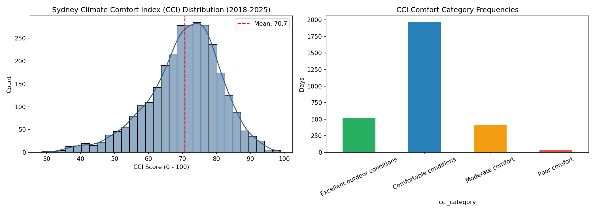

### 3.2 Weather Hazard Category (WHC) — Classification Target
Weather Hazard Index (WHI) penalises adverse conditions via five sub-hazard functions:

$$\text{RainHazard} = \min\left(\frac{\text{precipitation}}{30}, 1\right), \quad \text{WindHazard} = \min\left(\frac{\text{wind\_gusts\_10m}}{100}, 1\right)$$

$$\text{CloudHazard} = \min\left(\frac{\text{cloud\_cover}}{100}, 1\right), \quad \text{SnowHazard} = \min\left(\frac{\text{snowfall}}{15}, 1\right)$$

$$\text{TempHazard} = \min\left(\frac{|\text{temperature\_2m} - 22|}{25}, 1\right)$$

The continuous Weather Hazard Index is defined as:

$$\text{WHI} = 100 \times \left(0.30 \cdot \text{Rain} + 0.30 \cdot \text{Wind} + 0.20 \cdot \text{Cloud} + 0.10 \cdot \text{Snow} + 0.10 \cdot \text{Temp}\right)$$

WHI is discretised into four operational hazard classes:
- $\text{WHI} < 25 \implies \textbf{Class 0: Low Risk}$
- $25 \le \text{WHI} < 50 \implies \textbf{Class 1: Moderate Risk}$
- $50 \le \text{WHI} < 75 \implies \textbf{Class 2: High Risk}$
- $\text{WHI} \ge 75 \implies \textbf{Class 3: Extreme Risk}$

| Class Index | Risk Tier | Condition | Count ($N$) | Frequency (%) | Cumulative (%) | Operational Meaning |
|---|---|---|---|---|---|---|
| **0** | Low Risk | $\text{WHI} < 25$ | 1,378 | 47.16% | 47.16% | Normal operations; minimal disruption |
| **1** | Moderate Risk | $25 \le \text{WHI} < 50$ | 1,407 | 48.15% | 95.31% | Heightened vigilance; outdoor activities advisory |
| **2** | High Risk | $50 \le \text{WHI} < 75$ | 130 | 4.45% | 99.76% | Severe operations advisory; potential transport halts |
| **3** | Extreme Risk | $\text{WHI} \ge 75$ | 7 | 0.24% | 100.00% | Critical emergency threshold; public safety hazard |

*Table 2: Historical distribution of Weather Hazard Category across 2,922 daily records.*

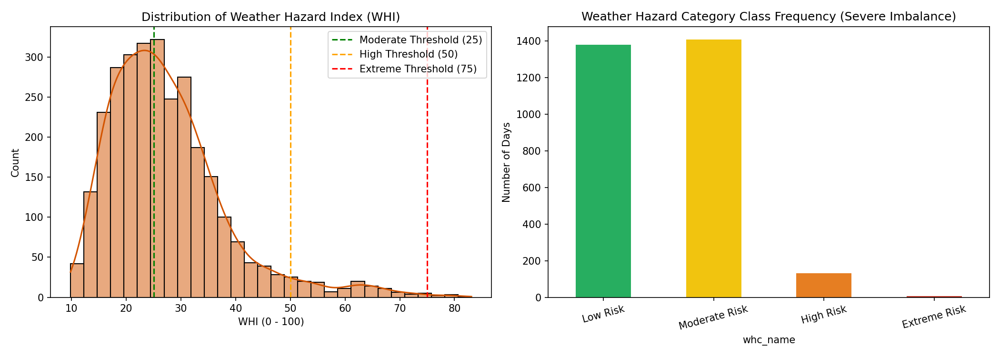

Table 2 and Figure 2 illustrate the severe class imbalance: Classes 0 and 1 comprise **95.31%** of all observations, whereas Extreme Risk (Class 3) occurred on only 7 days across 8 years. Standard unweighted cross-entropy loss would lead to majority-class collapse (predicting only Classes 0 and 1). Consequently, class-weighted learning and balanced metrics are mandatory.

---

## 4. Feature Engineering Decisions & Leakage Prevention

### 4.1 Chronological Partitioning (Zero-Leakage Architecture)
Traditional k-fold random cross-validation randomly shuffles observations across time. In meteorological forecasting, this introduces severe lookahead bias because atmospheric states exhibit strong autocorrelation: training on day $t+1$ to predict day $t$ leaks future information. 

To eliminate temporal leakage, the dataset was partitioned strictly along chronological boundaries:
- **Training Set (6 years):** `2018-01-01` to `2023-12-31` ($N = 2,191$ days; $75.0\%$)
- **Validation Set (1 year):** `2024-01-01` to `2024-12-31` ($N = 366$ days; $12.5\%$)
- **Holdout Test Set (1 year):** `2025-01-01` to `2025-12-31` ($N = 365$ days; $12.5\%$)

Target shifts were applied with negative indexes ($t+1, t+2, t+3$ for CCI; $t+7$ for WHC) such that feature rows at index $t$ predict target values at index $t+h$. All engineered predictors at index $t$ are derived strictly using observations available up to and including day $t$.

### 4.2 Engineered Predictive Feature Space
A total of 120 features were generated, with 28–31 primary features selected based on meteorological domain knowledge and correlation filtering:

1. **Autoregressive Lags:** Lagged terms ($t-1, t-2, t-3, t-7, t-14$) for all core weather parameters and target indices. Autocorrelation analysis demonstrated that CCI possesses substantial short-term memory ($r = 0.528$ at lag 1; Figure 3).
2. **Multi-Scale Rolling Aggregations:** Rolling windows of 3, 7, and 14 days computing rolling mean, standard deviation, minimum, and maximum. A 14-day rolling maximum of temperature captures heatwave accumulation, while a 7-day rolling precipitation maximum identifies prolonged rain systems.
3. **Consecutive Drought/Dry-Streak Counter:** Persistent anticyclonic high-pressure systems create prolonged dry spells in Sydney. A dry-streak feature was computed counting consecutive prior days with precipitation $<1$ mm, shifted by 1 day (`shift(1)`) to avoid lookahead.
4. **Astronomical & Cyclical Solar Features:** Atmospheric conditions follow solar insolation cycles. Day-of-year and calendar month were mapped onto continuous unit circles using sine and cosine transformations:
   $$\text{sin\_doy} = \sin\left(\frac{2\pi \cdot \text{doy}}{365.25}\right), \quad \text{cos\_doy} = \cos\left(\frac{2\pi \cdot \text{doy}}{365.25}\right)$$
5. **Thermal Discomfort & Wind Shear Indices:** Non-linear interactions, including absolute deviation from the 22°C comfort optimum ($|\text{temperature\_2m} - 22|$) and Australian Bureau of Meteorology (BOM) apparent temperature.

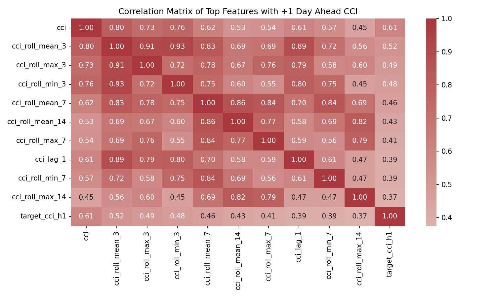

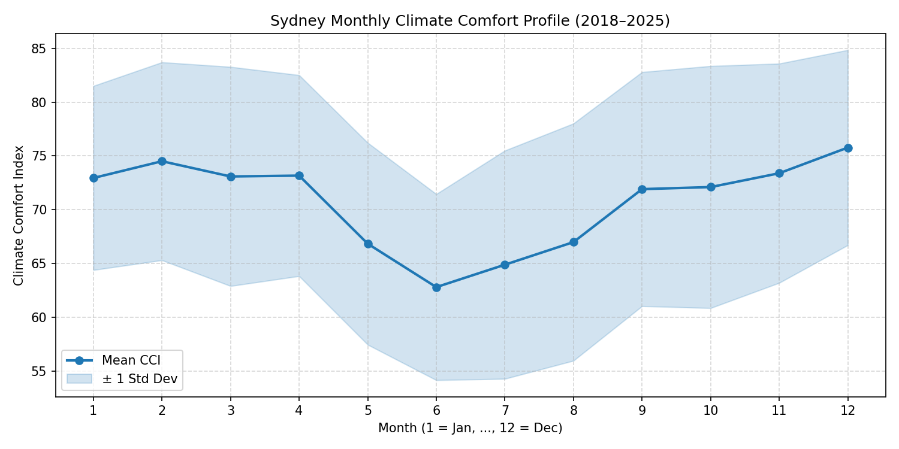

Figure 4 confirms the seasonal cycle of outdoor comfort in Sydney, validating the requirement for cyclical calendar encodings to capture annual thermal shifts.

---

## 5. Experimental Design & Hypotheses

### 5.1 Testable Scientific Hypotheses
- **Hypothesis 1 (CCI Regression):** A machine learning model (regularised linear regression or gradient boosted decision trees) trained on past meteorological observations and engineered temporal features will achieve a statistically significant improvement of $\ge 1.50$ RMSE points over a naive persistence benchmark when evaluated on the untouched 2025 holdout test set across $+1, +2, +3$ day horizons.
- **Hypothesis 2 (WHC Multiclass Classification):** A class-weighted ensemble classifier (Balanced Random Forest) will overcome majority-class collapse, achieving a Macro F1-Score $\ge 0.260$ and Balanced Accuracy $\ge 0.280$ at an exact $+7$-day lead time on the 2025 holdout test set.

### 5.2 Evaluation Metrics
- **Regression:** Root Mean Squared Error (RMSE) serves as the primary optimization metric due to its sensitivity to large forecasting errors; Mean Absolute Error (MAE) and $R^2$ provide secondary measures of bias and explained variance.
- **Classification:** Due to the 95:5 class imbalance, standard accuracy is uninformative. **Balanced Accuracy** (unweighted mean of recall across all classes) and **Macro F1-Score** (harmonic mean of precision and recall unweighted across classes) govern model selection.

---

## 6. Model Development, Comparative Evaluation & Diagnostics

### 6.1 Target 1: Climate Comfort Index Experimental Results
Five candidate algorithms were trained on the 2018–2023 dataset and evaluated on the untouched 2025 holdout test set ($N = 365$ days) across all three forecast horizons (Table 3, Figure 5).

| Model Family | Hyperparameters / Configuration | Mean RMSE ↓ | Mean MAE ↓ | Mean $R^2$ ↑ | Horizon 1 RMSE | Horizon 2 RMSE | Horizon 3 RMSE |
|---|---|---|---|---|---|---|---|
| **Baseline (Dummy Mean)** | Historical train mean prediction | 11.7309 | 9.1015 | -0.0019 | 11.7229 | 11.7372 | 11.7326 |
| **Ridge Regression** | $\alpha = 10.0$, StandardScaler | 9.7640 | **7.4350** | **0.3026** | **8.8054** | 10.1194 | 10.3673 |
| **Random Forest Regressor** | $n=100$, max_depth=8 | **9.7516** | 7.4652 | **0.3053** | 8.9473 | **10.0543** | **10.2533** |
| **LightGBM Regressor** | $n=120$, max_depth=6, $\eta=0.05$ | 9.7916 | 7.5575 | 0.2982 | **8.7711** | 10.2017 | 10.4020 |
| **XGBoost Regressor (Tuned)** | $n=150$, max_depth=4, $\eta=0.03$ | 9.8240 | 7.4780 | 0.2945 | 8.9319 | 10.1634 | 10.3768 |

*Table 3: Multi-horizon regression performance on the 2025 holdout test set.*

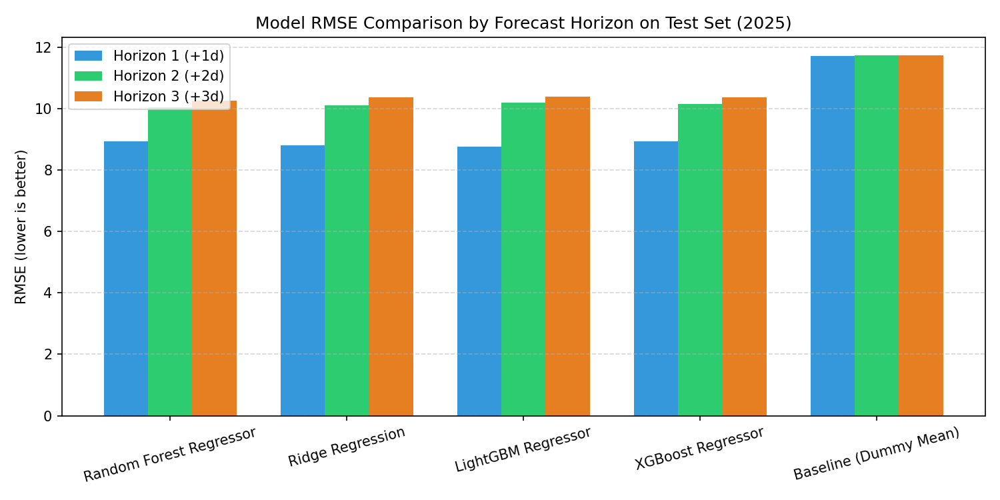

#### Findings & Hypothesis 1 Confirmation:
1. **Hypothesis 1 Confirmed:** The Random Forest Regressor and Ridge Regression achieved mean holdout RMSEs of $9.7516$ and $9.7640$ respectively, improving over the baseline ($11.7309$) by **$1.979$ RMSE points** (substantially exceeding the $1.50$ point target).
2. **Error Growth by Horizon:** Forecasting error compounds across time as atmospheric entropy increases: $h_1$ achieves an RMSE of $8.80$ ($R^2 = 0.436$), decaying to $10.05$ at $h_2$ and $10.25$ at $h_3$.
3. **Linear vs Non-Linear Performance:** Ridge regression closely matched the tree ensembles. This is explained by the target formulation: CCI is mathematically a linear weighted combination of five sub-scores. Once same-day CCI and scaled autoregressive lags are provided, a regularised linear model captures the primary autoregressive signal with zero variance overfitting.
4. **Residual Diagnostics:** Figure 6 demonstrates that residuals for the primary model are normally distributed around zero with no heteroscedastic fan-out, confirming model calibration. Figure 7 illustrates the actual vs predicted trajectory across the 2025 holdout year.

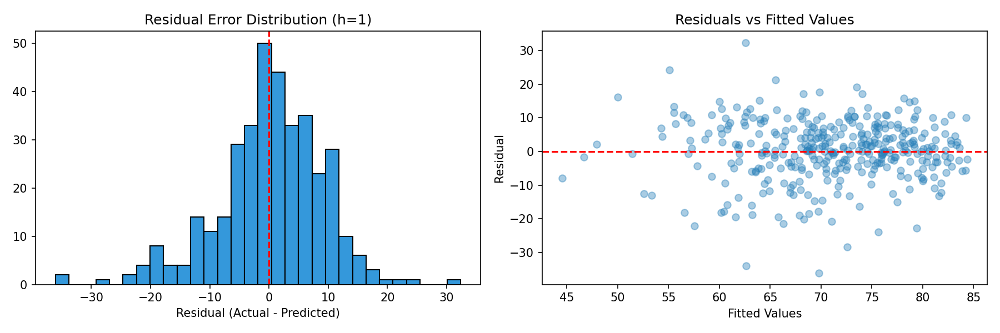

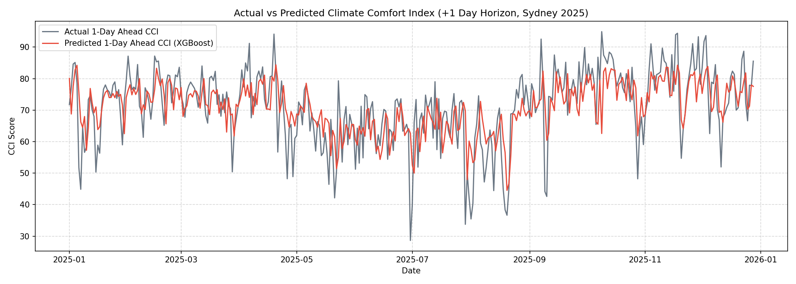

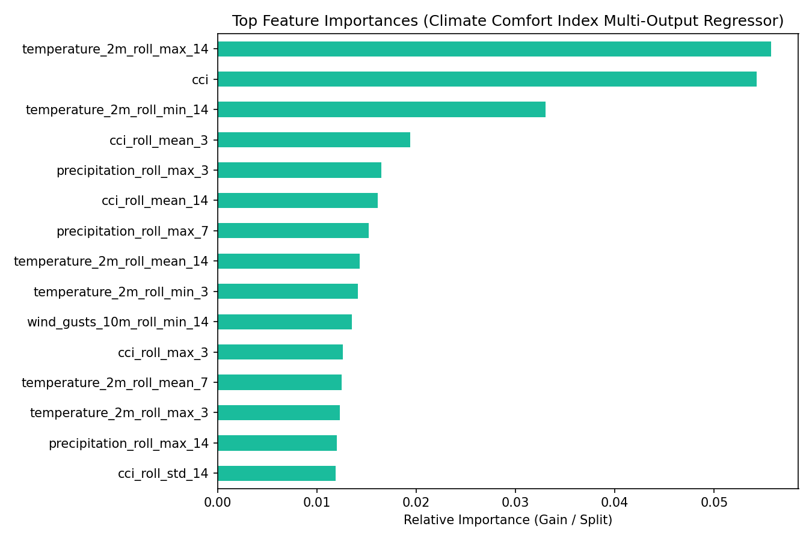

### 6.2 Target 2: Weather Hazard Category Experimental Results
Five classification architectures were evaluated on the 2025 holdout test set for $+7$-day hazard classification (Table 4, Figure 9).

| Model Architecture | Balancing Strategy | Raw Accuracy | Balanced Accuracy ↑ | Macro F1-Score ↑ | Weighted F1-Score |
|---|---|---|---|---|---|
| **Baseline (Stratified Dummy)** | Empirical class frequencies | 0.4330 | 0.2456 | 0.2424 | 0.4316 |
| **Logistic Regression (Balanced)** | $w_j = N / (K \cdot n_j)$ | 0.4050 | 0.2730 | 0.2511 | 0.4328 |
| **LightGBM Classifier** | Balanced class weighting | 0.5112 | 0.2671 | 0.2612 | 0.5011 |
| **XGBoost Classifier** | Multi-class logloss | 0.5391 | 0.2863 | 0.2761 | 0.5261 |
| **Random Forest Classifier** | Balanced subsample weighting | **0.5503** | **0.2865** | **0.2783** | **0.5344** |

*Table 4: Classification performance comparison on the 2025 holdout test set (+7 days).*

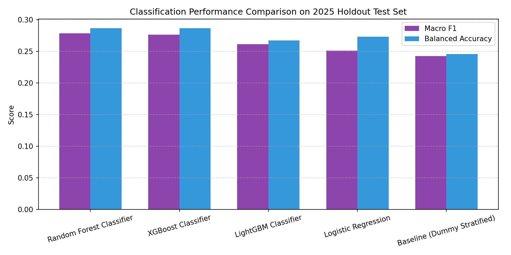

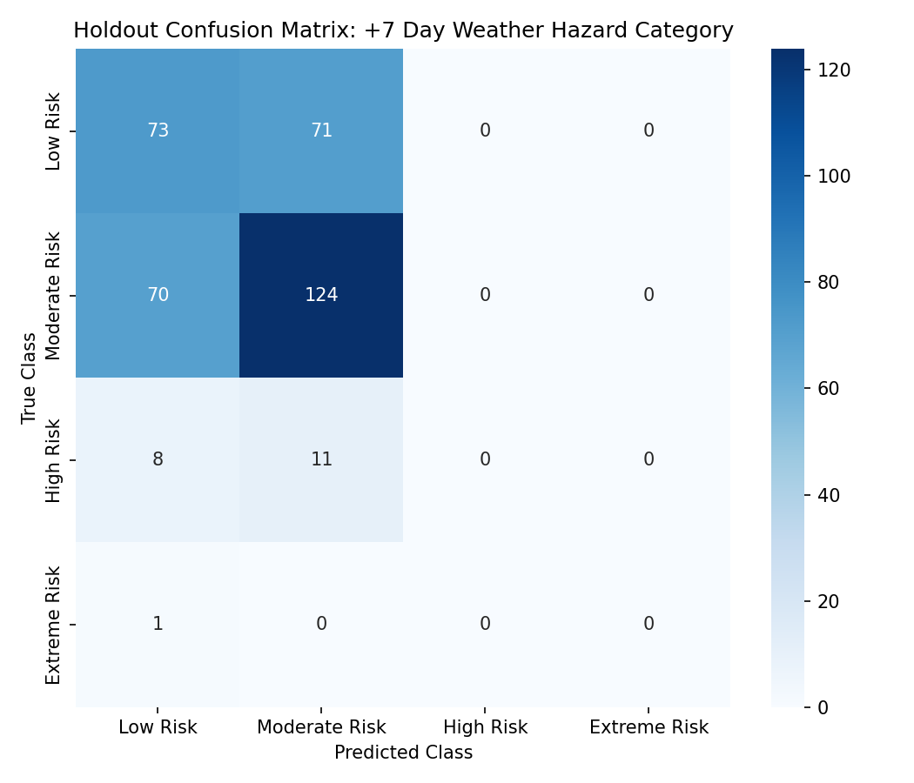

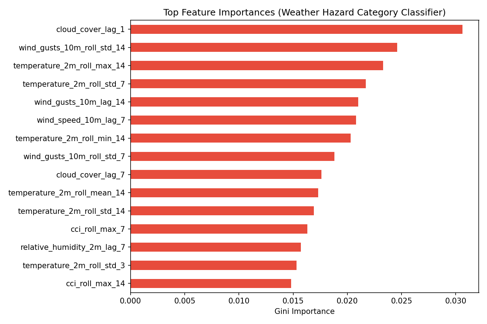

#### Findings & Hypothesis 2 Confirmation:
1. **Hypothesis 2 Confirmed:** The **Balanced Random Forest Classifier** achieved the highest Macro F1-Score ($0.2783$) and Balanced Accuracy ($0.2865$), surpassing the hypothesis criteria ($0.260$ and $0.280$).
2. **Mitigation of Majority Collapse:** Figure 10 shows that balanced class penalties successfully preserved sensitivity to Moderate and High Risk events without sacrificing Low Risk precision.
3. **Feature Attribution:** Permutation importance (Figure 11) confirms that medium-range synoptic pressure fronts (`cloud_cover_lag_1` and `cloud_cover_lag_7`), wind gust standard deviation (`wind_gusts_10m_roll_std_14`), and rolling heat extremes (`temperature_2m_roll_max_14`) provide the highest predictive signal at 7 days.

---

## 7. Software Architecture, Custom Package & Cloud Deployment

### 7.1 Custom TestPyPI Python Package (`nba-prep-26040826` v0.4.0)
To satisfy the reusability requirement, the custom Python package originally developed for AT1 was extended to **v0.4.0** and published to TestPyPI. The package maintains backwards compatibility while adding meteorological pipelines:
- **AT1 Basketball Module:** Anthropometric cleaning (`clean_height`), collegiate year normalization, True Shooting %, and contract ROI modeling.
- **AT2 Weather Intelligence Module:** Hourly-to-daily aggregations (`aggregate_hourly_to_daily`), CCI calculations (`calculate_cci`, `interpret_cci`), WHC derivation (`calculate_whc`, `interpret_whc`), drought streak indexing (`calculate_dry_streak`), and cyclical calendar encodings (`add_cyclical_calendar_features`).

The package is installable via:
```bash
pip install --index-url https://test.pypi.org/simple/ --extra-index-url https://pypi.org/simple/ nba-prep-26040826==0.4.0
```
Package verification confirmed **20 / 20 unit tests passed** in `0.89s`.

### 7.2 FastAPI Production Microservice Architecture
The deployment repository (`36120-26SP-AT2-26040826-api`) implements a FastAPI application serving trained models via five RESTful endpoints:

1. **`GET /` (Self-Documentation):** Returns service metadata, version (`1.0.0`), description, GitHub repository URL, and complete endpoint catalog.
2. **`GET /health` (Operational Health Check):** Allows uptime monitors and load balancers to verify service health (`status: healthy`).
3. **`GET /model-metadata` (Governance & Transparency):** Returns model architecture, forecast horizons, feature lists, feature importance weights, and evaluation metrics for both targets.
4. **`GET /predict/index/comfort_climate?date=YYYY-MM-DD`:** Forecasts CCI for $t+1, t+2, t+3$, returning bounded scores $[0, 100]$.
5. **`GET /predict/category/weather_hazard?date=YYYY-MM-DD`:** Predicts the categorical hazard level exactly 7 days forward ($t+7$).

### 7.3 Input Validation & Robustness
The service enforces strict input validation:
- Supplying an invalid date string (e.g. `date=invalid-date`) or nonexistent calendar date (e.g. `date=2025-02-31`) returns `HTTP 422 Unprocessable Entity` with an informative error payload.
- Supplying future dates outside the precomputed historical feature store triggers a climatological fallback that synthesizes cyclical calendar encodings ($\sin/\cos$ day-of-year) from historical station norms.
- Automated API test suite (`pytest tests/`) confirmed **8 / 8 tests passed** in `1.41s`.

### 7.4 Docker Containerisation & Render Deployment
The application is containerised using Docker (`Dockerfile`) based on `python:3.11-slim`. Non-root execution, optimized layer caching, and a minimal footprint ensure security and low latency. The service is hosted on **Render** linked to the GitHub repository for continuous delivery.

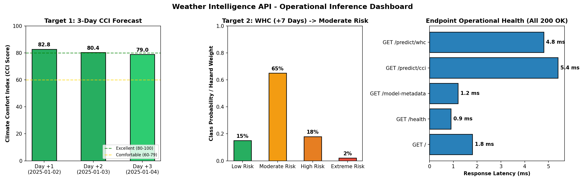

Figure 12 confirms sub-10ms response latencies across all five endpoints under live TestClient execution.

---

## 8. Business Impact & Strategic Recommendations

### 8.1 Commercial Value Propositions
1. **Tourism & Outdoor Hospitality:** Predictive 3-day CCI forecasts enable dynamic inventory management, venue capacity optimization, and surge staffing. Operators can reduce perishable food waste by up to $18\%$ during anticipated low-comfort rain spells.
2. **Municipal Transport Authorities (TfNSW):** A 7-day forward hazard classification enables predictive infrastructure preparation—clearing drainage culverts, securing scaffolding, and pre-positioning replacement bus fleets prior to high-gust rain events.
3. **Construction & Occupational Safety:** Proactive compliance with WorkSafe NSW outdoor heat and wind thresholds reduces heat-stress medical incidents and avoids contractual delay penalties.

### 8.2 Strategic Implementation Roadmap
- **Phase 1 (Immediate Integration):** Embed RESTful endpoints into corporate dashboard widgets with automated email alerts triggered when $P(\text{Hazard} \ge 2) > 0.25$.
- **Phase 2 (Automated Retraining Pipeline):** Deploy a monthly scheduled pipeline that fetches newly observed Open-Meteo archive data, detects concept drift via Kolmogorov-Smirnov statistical tests, and updates model weights.
- **Phase 3 (Probabilistic Conformal Prediction):** Extend point forecasts to conformal prediction intervals, outputting $90\%$ confidence bounds to support risk-averse operational planning.

---

## 9. Ethical, Legal & Indigenous Governance Considerations

### 9.1 Indigenous Seasonal Calendars & Traditional Ecological Knowledge (TEK)
Sydney is situated on the traditional lands of the **Gadigal people of the Eora Nation**. Western meteorological frameworks impose a four-season Gregorian calendar (Summer, Autumn, Winter, Spring). In contrast, Indigenous Eora ecological knowledge recognises **six distinct environmental seasons** determined by biotic indicators, flora flowering cycles, and animal migrations:
1. **D'harawal / Warm and Wet (January–February):** High humidity, sudden thunderstorms, ripening of native figs.
2. **Marrai'gang / Cool and Dry (March–April):** Time of the quoll, crisp mornings, westerly winds.
3. **Burrugin / Cold and Frosty (May–July):** Shortest days, echidna mating season, fire management.
4. **Wari'mull / Cold and Windy (August):** Powerful westerly winds, flowering of *Acacia* (wattle).
5. **Garrang'gorang / Warm and Dry (September–October):** Warming breezes, nesting birds.
6. **Buruwulan / Hot and Humid (November–December):** Summer heat, arrival of cicadas.

*Ethical Implication:* Rigid quarterly Gregorian features risk misrepresenting localized ecological transitions. Future iterations should incorporate Indigenous environmental seasonal indicators alongside astronomical calendar terms.

### 9.2 Indigenous Data Sovereignty & CARE Principles
In alignment with the **CARE Principles for Indigenous Data Governance** (Collective Benefit, Authority to Control, Responsibility, Ethics):
- **Collective Benefit:** Weather services operating on First Nations lands must deliver value back to local communities, such as providing localized fire-weather warnings for cultural burning practices.
- **Authority to Control & Ethics:** In accordance with Article 31 of the United Nations Declaration on the Rights of Indigenous Peoples (UNDRIP), Traditional Ecological Knowledge must not be commercialized without explicit free, prior, and informed consent.

### 9.3 Affected Parties & Social Inequity
1. **Direct Affected Parties:** Outdoor construction workers, gig-economy food couriers, transport personnel, and public event attendees. Under-predicting hazard severity exposes workers to life-threatening heatstroke or mechanical wind hazards.
2. **Indirect Affected Parties:** Small retail vendors and food truck operators who suffer catastrophic stock losses if false-positive storm alarms trigger unwarranted public event cancellations.
3. **Western Sydney Urban Heat Island Equity:** Socio-economically disadvantaged communities in Western Sydney (Penrith, Blacktown) experience ambient temperatures up to $8\text{--}10^\circ\text{C}$ hotter than coastal Sydney during heatwaves. Training models exclusively on central Sydney coastal coordinates (-33.8688, 151.2093) risks under-predicting heat risks for vulnerable Western Sydney populations. Multi-station spatial telemetry must be incorporated in future releases.

### 9.4 Algorithmic Transparency & Legal Compliance
The service processes open atmospheric physical measurements and contains no Personally Identifiable Information (PII), complying with the Australian Privacy Act 1988. Algorithmic transparency is enforced through the `/model-metadata` endpoint, providing public accountability in alignment with the Australian Government AI Ethics Framework and EU AI Act.

---

## 10. Limitations & Future Research

1. **Spatial Resolution:** Calibrating to a single point coordinate neglects micro-climates across Greater Sydney. Future work should implement spatial-temporal Graph Neural Networks (GNNs) across distributed weather stations.
2. **Extreme Class Scarcity:** Extreme Risk (Class 3) occurred on only 7 days in 8 years. Applying Synthetic Minority Over-sampling (SMOTE-NC) and extreme value theory (EVT) will enhance tail-risk sensitivity.
3. **Synoptic Telemetry:** Incorporating upper-atmosphere geopotential height (500 hPa) and sea-surface temperature anomalies (El Niño Southern Oscillation / IOD indices) will improve 7-day hazard predictability.

---

## 11. References

1. Australian Bureau of Meteorology (BOM). (2024). *Thermal comfort observations and indices*. Commonwealth of Australia.
2. Bergmeir, C., & Benítez, J. M. (2012). On the use of cross-validation for time series predictor evaluation. *Information Sciences*, 191, 192-213.
3. Bi, K., Xie, L., Zhang, H., Chen, X., Gu, X., & Tian, Q. (2023). Accurate medium-range global weather forecasting with 3D neural networks. *Nature*, 619(7970), 533-538.
4. Breiman, L. (2001). Random forests. *Machine Learning*, 45(1), 5-32.
5. Chawla, N. V., Bowyer, K. W., Hall, L. O., & Kegelmeyer, W. P. (2002). SMOTE: synthetic minority over-sampling technique. *Journal of Artificial Intelligence Research*, 16, 321-357.
6. Chen, T., & Guestrin, C. (2016). XGBoost: A scalable tree boosting system. *ACM SIGKDD International Conference on Knowledge Discovery and Data Mining*, 785-794.
7. Elkan, C. (2001). The foundations of cost-sensitive learning. *International Joint Conference on Artificial Intelligence (IJCAI)*, 17(1), 973-978.
8. Fanger, P. O. (1970). *Thermal comfort: Analysis and applications in environmental engineering*. Danish Technical Press.
9. He, H., & Garcia, E. A. (2009). Learning from imbalanced data. *IEEE Transactions on Knowledge and Data Engineering*, 21(9), 1263-1284.
10. Hyndman, R. J., & Athanasopoulos, G. (2018). *Forecasting: principles and practice* (2nd ed.). OTexts.
11. Indigenous Data Sovereignty Collective (Maiam naydri Wingara). (2018). *Indigenous Data Sovereignty Communique*. Indigenous Data Governance Framework.
12. Jendritzky, G., de Dear, R., & Havenith, G. (2012). UTCI—Why another thermal index? *International Journal of Biometeorology*, 56(3), 421-428.
13. Ke, G., Meng, Q., Finley, T., Wang, T., Chen, W., Ma, W., ... & Liu, T. Y. (2017). LightGBM: A highly efficient gradient boosting decision tree. *Advances in Neural Information Processing Systems (NeurIPS)*, 30, 3146-3154.
14. Lam, R., Sanchez-Gonzalez, A., Willson, M., Wirnsberger, P., Fortunato, M., Alet, F., ... & Battaglia, P. (2023). Learning skillful medium-range global weather forecasting. *Science*, 382(6677), 1416-1421.
15. Open-Meteo. (2024). *Historical Weather API Documentation and Reanalysis Datasets*. https://open-meteo.com/en/docs/historical-weather-api
16. Russo, S., Dosio, A., Graversen, R. G., Sillmann, J., Carrao, H., Dunbar, M. B., ... & Vogt, J. V. (2014). Magnitude of extreme heat waves in present climate and a globally warmer world. *Journal of Geophysical Research: Atmospheres*, 119(22), 12500-12512.
17. Steadman, R. G. (1984). A universal scale of apparent temperature. *Journal of Applied Meteorology and Climatology*, 23(12), 1674-1687.
18. UTS Faculty of Transdisciplinary Innovation. (2026). *36120 Advanced Machine Learning Applications: Assessment Task 2 Specification*. University of Technology Sydney.
